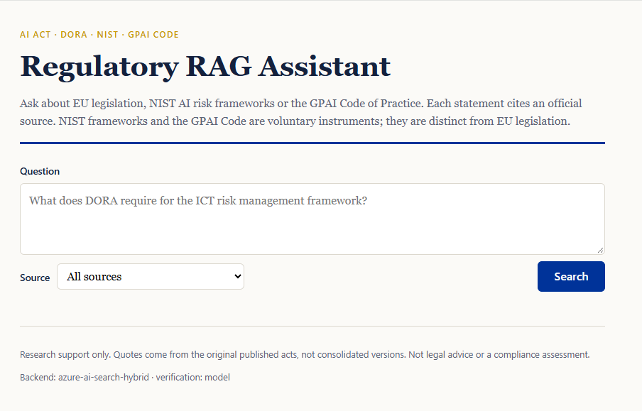
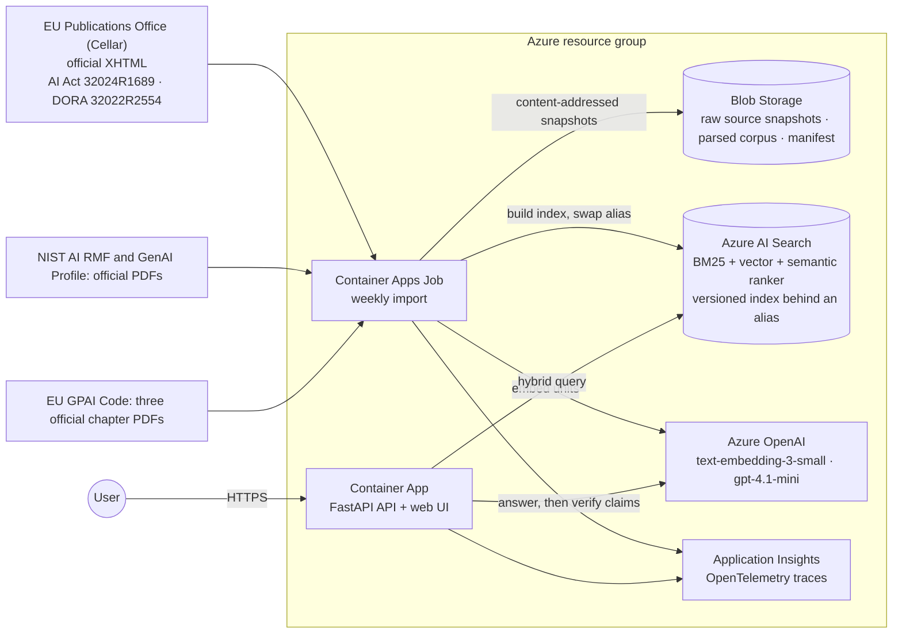

# Regulatory RAG Assistant v2

Imports the EU AI Act, DORA, NIST AI RMF 1.0, the NIST Generative AI Profile and the three chapters of the EU GPAI Code of Practice from official sources. Generates cited answers with Azure OpenAI. The repository includes a CLI and a FastAPI web UI. The Azure deployment configuration uses Container Apps for the API, UI and weekly import job, and Azure AI Search for hybrid retrieval.

## Web interface



## Documents and example questions

**What can I ask this assistant?** Questions about the imported EU regulations,
AI risk frameworks and GPAI Code chapters. It retrieves official excerpts and,
when a model is configured, uses them to generate cited answers.

| Document | What it covers | Example question |
| --- | --- | --- |
| **EU AI Act** | AI regulation, including prohibited practices, requirements for high-risk systems and transparency. | “What transparency obligations apply to chatbots under Article 50?” |
| **DORA** | Digital operational resilience in the financial sector: ICT risk management, incidents, testing and third-party risk. | “What does Article 6 say about the ICT risk management framework?” |
| **NIST AI RMF 1.0** | Voluntary AI risk management through GOVERN, MAP, MEASURE and MANAGE. | “How do the four core functions support AI risk management?” |
| **NIST AI 600-1: GenAI Profile** | Generative AI risks and suggested actions, including confabulation, information security and evaluation. | “What does action MS-2.5-003 recommend about checking sources and citations?” |
| **GPAI Code — Transparency** | Technical documentation and information for downstream providers of AI systems. | “What information do signatories provide to downstream providers?” |
| **GPAI Code — Copyright** | Copyright policies and identification of rights reservations when collecting training data. | “How do signatories respect rights reservations expressed through robots.txt?” |
| **GPAI Code — Safety and Security** | Assessment and mitigation of systemic risks for general-purpose AI models with systemic risk. | “What Safety and Security Framework do signatories adopt under Commitment 1?” |

**Are all these documents law?** AI Act and DORA are EU regulations. NIST documents
are voluntary guidance; the GPAI Code is a voluntary compliance instrument with
commitments for signatories. Answers should preserve these distinctions.

These are example research questions, not guaranteed successful answers. The corpus
uses the editions listed below; new-source model and Azure validation remain open.
Without model configuration, the local application returns excerpts only.

## Project status

| Component | Validation |
| --- | --- |
| Final local regression | 24 November 2026: 140 tests, lint, locked-dependency audit, UI regression and seven-source API smoke passed. Retrieval remains 8/8 for EU articles and 9/10 for guidance locators; current seven-source model/Azure validation is still open. [Final local evidence](evidence/final-local-validation-2026-11-24.json) · [Final session in Git Bash](docs/final-validation.md). |
| Additional AI guidance | Live local import and retrieval evaluated on 24 November 2026; 9/10 expected source locators retrieved, 6/10 ranked first and 2/2 controls without evidence. These new-source results do not establish model answer quality or Azure integration. [Evidence](evidence/ai-guidance-validation-2026-11-24.md). |
| CLI pilot | Completed on 13 November 2026 with local TF-IDF retrieval and Azure OpenAI `gpt-4.1-nano`. The expected article ranked first for 8/8 answerable questions and appeared in citations for 7/8 after verification. Both controls correctly abstained, with zero execution errors across all ten questions. |
| FastAPI and web UI | Local browser smoke test passed for a cited response and an abstention. Both questions also passed through the deployed Azure API with hybrid Azure AI Search and Azure OpenAI. See the [deployment and test manual](evidence/web-validation-manual.md). |

The [final pilot review](evidence/eval-20261113T130444Z-review.md) records two important outcomes: verification rejected an unsupported exception in A02 and accepted an overgeneralised claim about DORA's simplified framework in D02. Claim support still requires manual review.

The official-source import covered 113/113 AI Act and 64/64 DORA articles across 1,478 citable units, as recorded in the [pre-deployment report](evidence/azure-stack-validation-2026-11-12.md). V2 builds on the [v1 pilot](https://github.com/JeanneBM/regulatory-rag-assistant/blob/main/evidence/regulatory-rag-validation-2026-11-09.md) with point-level quotations and claim-support verification. The tool supports research. It does not give legal advice or assess compliance.

## NIST AI RMF 1.0

The default import also fetches the official [NIST AI 100-1 PDF](https://doi.org/10.6028/NIST.AI.100-1), version 1.0 (January 2023). This is **voluntary guidance, not EU legislation**. Source type and version travel through retrieval, generation and citations; the answer prompt preserves this distinction and a rule rejects obligation wording for NIST claims under the default strict policy.

```bash
regrag ingest
regrag ask "How does the framework describe GOVERN, MAP, MEASURE and MANAGE?" --act NIST_AI_RMF
```

The CLI, API `act` filter and web source selector accept `NIST_AI_RMF`. The importer preserves the original PDF bytes and SHA-256, validates the 48-page version and extracts page-addressable units with `#page=N` citation links. Page numbers refer to PDF viewer pages, not printed page numbers. Missing text, unexpected content types, redirects or a failed import leave the active corpus unchanged. Page-based extraction can split tables across pages; claim support still needs review.

Existing local corpora are refreshed automatically when NIST is absent. Azure requires deploying this code and rerunning the ingest job to build the new versioned index (schema v2). No Azure deployment or model evaluation is implied by local validation. See [NIST validation](evidence/nist-ai-rmf-validation-2026-11-19.json).

## Additional AI guidance

| CLI/API source filter | Official document | Edition and status |
| --- | --- | --- |
| `NIST_GENAI` | [NIST AI 600-1: Generative AI Profile](https://doi.org/10.6028/NIST.AI.600-1) | July 2024; voluntary guidance, 64 PDF pages |
| `GPAI_TRANSPARENCY` | [GPAI Code: Transparency](https://ec.europa.eu/newsroom/dae/redirection/document/118120) | Final, 10 July 2025; 6 PDF pages |
| `GPAI_COPYRIGHT` | [GPAI Code: Copyright](https://ec.europa.eu/newsroom/dae/redirection/document/118115) | Final, 10 July 2025; 6 PDF pages |
| `GPAI_SAFETY_SECURITY` | [GPAI Code: Safety and Security](https://ec.europa.eu/newsroom/dae/redirection/document/118119) | Final, 10 July 2025; 43 PDF pages |

The [Commission's source page](https://digital-strategy.ec.europa.eu/en/policies/contents-code-gpai)
identifies the Code as a voluntary compliance instrument for general-purpose AI model
providers. Commitments refer to signatories; the Safety and Security chapter concerns
models with systemic risk. These instruments are not additional EU regulations.
The source type and edition are carried into model inputs, citations and evaluation reports.

The new PDF editions are pinned by reviewed SHA-256 values, page counts and document
markers in `sources.py`. Import rejects changed bytes and redirects. The Commission's
PDF endpoints currently send a nonstandard MIME header; the importer checks the PDF
signature and exact reviewed hash rather than trusting that header. Downloads are
bounded while streaming, and original PDF bytes are preserved. Text is Unicode NFKC
normalised for retrieval; quotations use that extracted text, with original viewer-page
links. Tables can still span pages; a page hit is not proof of answer correctness.

```bash
regrag ingest
regrag ask "What does the profile say about confabulation?" --act NIST_GENAI
regrag ask "How are rights reservations handled?" --act GPAI_COPYRIGHT
regrag eval --cases eval/ai-guidance.json --retrieval-only
```

Existing local corpora refresh when any registered source is missing. Azure needs an
updated application image and a successful ingest before these source filters work.
See [current validation and remaining gates](evidence/ai-guidance-validation-2026-11-24.md).

## Architecture



| Azure service | Role | Security defaults |
| --- | --- | --- |
| Azure OpenAI (AI Services) | `chat` (gpt-4.1-mini) for answers and claim verification; `embedding` (text-embedding-3-small) | `disableLocalAuth`, Entra ID only |
| Azure AI Search (Basic) | Hybrid BM25 + HNSW vector search, semantic reranking, one index per corpus snapshot behind the `regrag` alias | `disableLocalAuth`, RBAC only |
| Blob Storage | Raw official XHTML (SHA-256 named), parsed corpora, `active.json` manifest, eval reports | Shared keys and public access disabled, versioning, soft delete |
| Container Apps | Web app (scale to zero) and a scheduled job that imports every Monday | Optional IP allowlist, HTTPS only, non-root image |
| Container Registry | Image built remotely by `azd` | Admin user disabled, pull with `AcrPull` |
| Log Analytics + Application Insights | Traces with status, scores, claim labels, tokens, latency | App Insights local auth disabled |
| Managed identities | `id-web` (read-only) and `id-ingest` (write) | Least-privilege data-plane roles, see [rbac.bicep](infra/modules/rbac.bicep) |
| Cost Management budget (optional) | E-mail alerts at 80 % actual and 100 % forecast spend | |

## How an answer is built

1. **Import.** The job asks Cellar for each CELEX resource with `Accept: application/xhtml+xml` and `Accept-Language: eng`. Every redirect is upgraded to HTTPS and pinned to `publications.europa.eu`. EUR-Lex pages answer scripts with a WAF challenge, so they are only used as citation links. Any HTTP error, foreign redirect, unexpected content type or missing article stops the import.
2. **Citable units.** The parser reads the Official Journal layout, including the two-cell tables used for points. Each unit is one numbered paragraph, or a paragraph's lead-in plus one point with all its sub-points, for example *AI Act Article 5(1), point (c)* with conditions (i) and (ii). Chapter headings, annexes, signatures and recitals are excluded. Every article from 1 to N must be present.
3. **Index.** Units are embedded and uploaded to a new index named after the corpus digest, the embedding deployment and the schema version. The alias moves only after every document has been counted. An unchanged corpus re-uses its index, so the weekly import costs no embeddings. The previous index is kept for rollback, and older ones are deleted.
4. **Retrieve.** A hybrid keyword and vector query, filtered by act if requested, is re-ranked by the semantic ranker. The assistant abstains without calling the model when no result reaches the reranker threshold. The threshold is a provisional 1.2 out of 4 that needs calibration.
5. **Generate.** Azure OpenAI returns statements through a strict JSON schema. Each statement cites one excerpt ID from an enum of the excerpts actually supplied. **The model never writes quotations.** The application attaches the full text of the cited unit, so a quote cannot be invented, altered or cut before a condition. Excerpt IDs the model writes into a statement ("(E3)", "according to E3") are removed. At most four claims are kept; extras are dropped and counted rather than failing the answer.
6. **Verify.** Each claim is checked against its quotation. Rules first: figures and article references must appear in the cited text; a power ("may") must not become an obligation ("shall") or the reverse; the statement must not invent an exception, and must keep the exceptions, limiting qualifiers ("to their best extent", "where appropriate") and Annex scope limits of the cited text. Then a second model call answers five checks (actor, modality, conditions, exceptions, additions) and labels the claim `supported`, `partial` or `unsupported`; a `supported` label with a failed check is downgraded to `partial`. Under the default `strict` policy only `supported` claims are shown. Rejected claims are listed with the reason. If none remain, the answer is an abstention.

Truncated, filtered or refused model replies, malformed output and verifier inconsistencies are errors, never abstentions. The verifier is itself a model, so it reduces partial-support errors without eliminating them. Manual review remains part of the evaluation.

## Quick start (local, no Azure resources)

Python 3.11+:

```bash
python -m venv .venv && source .venv/bin/activate   # PowerShell: .venv\Scripts\Activate.ps1
pip install -e ".[local]"
regrag ask "What does DORA say about the ICT risk management framework?" --act DORA
regrag serve        # http://127.0.0.1:8000
```

The first command downloads both EU acts, both NIST PDFs and all three GPAI Code chapters automatically into `.local/`. No manual download is needed. Without Azure configuration the local backend uses TF-IDF and returns evidence only (`retrieval_only`). To generate answers locally, set `AZURE_OPENAI_ENDPOINT` and `AZURE_OPENAI_CHAT_DEPLOYMENT` (see [.env.example](.env.example)) and run `az login`.

## Evaluate the answer design first (no new Azure resources)

The core of v2 is three things: point-level quotations, quotes attached by the application, and per-claim verification. They can be tested without Azure AI Search or Container Apps, using local retrieval and an existing Azure OpenAI chat deployment (for example the one from v1):

```bash
pip install -e ".[local]"
export AZURE_OPENAI_ENDPOINT=https://<your-resource>.openai.azure.com/
export AZURE_OPENAI_CHAT_DEPLOYMENT=<your gpt-4.1-mini deployment>
export AZURE_OPENAI_API_KEY=<key>      # or omit and use `az login` with the Cognitive Services OpenAI User role
regrag eval
```

One run produces both sides of the comparison on the same retrieved fragments and the same generation. `summary.verification` reports claims generated and claims shown, rejections by rule and by the model, and whether the expected article was cited before and after verification. The Markdown report lists every claim, including the rejected ones with their quotes, and has a manual-review column. Filling in that column shows whether verification removed wrong claims or lost correct ones. Run the same ten questions against v1 to compare. Reports also name the chat and verifier deployments, and a generation error still records what was retrieved.

The first pilot and its manual review are in [evidence/](evidence/eval-20261113T115349Z-review.md): the model verifier passed 21 of 21 shown claims, of which manual review found 4 partial and 2 wrong. The rules for legal force, exceptions and qualifiers were added afterwards and are checked against those 26 reviewed claims (`tests/test_pilot_review.py`). That shows they do what was intended there, not how they generalise; the next pilot should add new questions.

The full Azure stack below is for running the assistant as a service. The first evaluation does not need it.

## Deploy to Azure

The [deployment and test manual](evidence/web-validation-manual.md) documents the commands, pass criteria and captured evidence for the local browser test and the Azure API smoke test.

Requirements: [Azure Developer CLI](https://aka.ms/azd), Azure CLI, and Owner (or Contributor plus Role Based Access Control Administrator) rights on the subscription, because the template assigns roles. No local Docker is needed because the image is built in Azure Container Registry.

```bash
azd auth login && az login
azd env new regrag-dev
azd env set AZURE_LOCATION polandcentral
azd env set REGRAG_ALLOWED_IP_RANGES "203.0.113.10/32"   # optional: restrict the web app to your IP
azd env set AZURE_BUDGET_AMOUNT 50 && azd env set AZURE_BUDGET_EMAIL you@example.com   # optional
azd up
```

`azd up` provisions [infra/main.bicep](infra/main.bicep), builds and deploys the image, then runs the [postdeploy hook](scripts/postdeploy.sh), which points the ingest job at the new image and starts the first import (about 2–5 minutes). Until the import finishes, questions fail with a search error. Follow the import:

```bash
az containerapp job execution list -n "$(azd env get-value INGEST_JOB_NAME)" -g "$(azd env get-value AZURE_RESOURCE_GROUP)" -o table
```

Then open `azd env get-value WEB_URL`, or run the CLI against the deployment:

```bash
azd env get-values > .env.azure && set -a && . ./.env.azure && set +a
regrag ask "Under the AI Act, what transparency obligations apply to chatbots?"
regrag eval          # full ten-question pilot; writes JSON and a manual-review Markdown table to .local/eval/
```

Your user gets the same data-plane roles as the ingest job, so `regrag ingest --target azure` also works from a workstation.

**Region.** The default recommendation is `polandcentral` (Warsaw). Azure AI Search there supports the semantic ranker. The model deployments use `DataZoneStandard`, so prompts and answers are processed inside the EU data zone, while the corpus, index and logs stay in Poland. Microsoft's [AI Search region list](https://learn.microsoft.com/azure/search/search-region-support) (updated 23 October 2026) says Sweden Central is in high demand and blocks the creation of new search services. Model availability changes, so check before deploying: `az cognitiveservices model list --location polandcentral -o table`.

**Parameters** (`azd env set NAME value`): `AZURE_OPENAI_CHAT_MODEL` / `_VERSION` (default `gpt-4.1-mini` / `2025-04-14`), `AZURE_OPENAI_CHAT_SKU` / `AZURE_OPENAI_EMBEDDING_SKU` (default `DataZoneStandard`; `GlobalStandard` may process in any region and sometimes has more capacity), `AZURE_SEARCH_SKU` (`basic`; `free` disables the semantic ranker and allows one service per subscription), `REGRAG_ALLOWED_IP_RANGES`, `AZURE_BUDGET_AMOUNT`, `AZURE_BUDGET_EMAIL`.

**Cost.** Azure AI Search Basic bills a fixed hourly rate and is the main fixed cost. Container Apps scale to zero. OpenAI is billed per token: v1's ten-question pilot used about 31k tokens, and v2 adds one verification call per answered question. Embedding both acts costs a fraction of a cent and is skipped when the corpus has not changed. Check prices for your region in the [Azure pricing calculator](https://azure.microsoft.com/pricing/calculator/). **Remove everything with `azd down --purge`.**

### CI/CD

| Workflow | Trigger | What it does |
| --- | --- | --- |
| [CI](.github/workflows/ci.yml) | push to `main`, pull requests | ruff, pytest (offline fakes for Cellar, OpenAI and Search), `pip-audit` on the hash-pinned lock, Bicep build and lint, Docker build and smoke test (non-root user, `/healthz`, CSP header) |
| [Live ingest](.github/workflows/live-ingest.yml) | weekly, relevant pull requests | Real import from Cellar, [structure checks](scripts/check_corpus.py) on the real text (article coverage, point tables, AI Act Art. 5(1)(c) sub-points, no chapter headings in units), retrieval-only pilot |
| [Deploy](.github/workflows/deploy.yml) | manual | `azd provision` and `azd deploy` with OpenID Connect federation, so no Azure secret is stored in GitHub |

For the deploy workflow, create an app registration with a federated credential for `repo:JeanneBM/regulatory-rag-assistant-v2:environment:azure`, grant it Owner on the subscription (or Contributor plus Role Based Access Control Administrator), and set the repository variables `AZURE_CLIENT_ID`, `AZURE_TENANT_ID`, `AZURE_SUBSCRIPTION_ID`, `AZURE_ENV_NAME` and `AZURE_LOCATION`.

## Security

- No secrets anywhere: OpenAI, Search, Storage and App Insights all have key auth disabled. The workloads use managed identities, and developers use `az login`.
- Separate identities: the web app can only read the index and the corpus, and only the ingest job can write.
- Questions and retrieved text are treated as untrusted. Prompts say so, outputs are schema-constrained, excerpt IDs are an enum, quotes are copied by the application, and the act filter is whitelisted before it enters an OData filter.
- The API validates input length, rate-limits per client (in memory, per replica), caps model-backed requests per day, returns generic 502s without provider details, and sends CSP, `nosniff`, `no-referrer` and `frame-ancestors 'none'` headers. The UI uses no third-party scripts. The OpenAPI UI is disabled.
- Telemetry records counts, scores, labels, tokens and latency. The question text is recorded only if `REGRAG_LOG_QUESTIONS=true`.
- Supply chain: hash-pinned runtime lock, `pip-audit` in CI, Actions pinned to commit SHAs, Dependabot for Actions, pip and the base image.
- The web endpoint is public unless `REGRAG_ALLOWED_IP_RANGES` is set. For other users, put Entra ID authentication (Container Apps authentication) in front of it.

## Configuration

All settings are environment variables, documented in [.env.example](.env.example) and [config.py](src/regrag/config.py). The most relevant: `REGRAG_BACKEND` (`local` | `azure`), `REGRAG_CLAIM_POLICY` (`strict` | `lenient`), `REGRAG_VERIFY_CLAIMS`, `REGRAG_MIN_RERANKER_SCORE`, `REGRAG_TOP_K`, `AZURE_OPENAI_VERIFIER_DEPLOYMENT` (to use a different model as the judge).

## Limitations

- The corpus is the original published acts, not consolidated versions. Amendments, corrigenda, delegated and implementing acts, annexes and recitals are not indexed. Retrieval timestamps are not dates of application.
- Retrieval thresholds are provisional, and the pilot set is small (8 answerable questions, 2 controls). Calibrate on 30–50 expert-reviewed questions, including adversarial ones, before relying on abstention behaviour.
- Claim verification is model-based and can be wrong in both directions. Keep the manual-review column in eval reports. The deterministic rules work on English quotations with English or Polish statements and catch only the patterns they name.
- Each claim is checked against its own quotation. An answer can consist only of supported claims and still mislead by omission, for example by leaving out an exemption in another paragraph (AI Act Article 53(2) in the first pilot).
- Point units carry the text introducing their list, so a claim drawn from that introduction is cited as the point.
- Rate limits and daily caps are per replica.

## Repository layout

```
src/regrag/      cellar.py (download) · parser.py (citable units) · ingest.py · storage.py (local/Blob)
                 search_index.py (schema, versioned build, alias swap) · retrieval.py (Azure hybrid, local TF-IDF)
                 generation.py · verification.py · pipeline.py · api.py + static/ · evaluation.py · cli.py
infra/           main.bicep + modules (openai, search, storage, registry, identities, rbac, apps, monitoring, budget)
eval/pilot.json  the ten pilot questions with expected articles
scripts/         azd postdeploy hooks, real-corpus structure checks
tests/           offline tests with fakes for Cellar, Azure OpenAI and Azure AI Search
evidence/        validation reports (added after each run)
```
